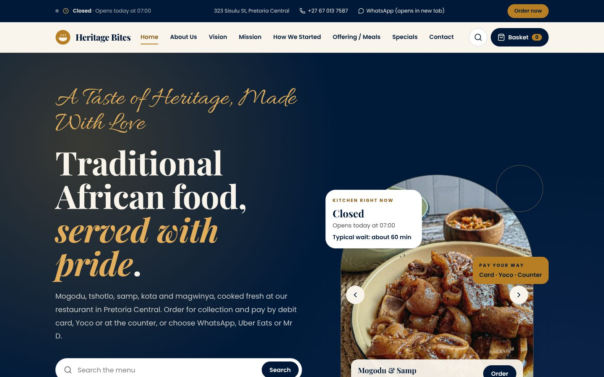

# Heritage Bites: online menu, ordering and staff console

A rebuilt website for **Heritage Bites**, a traditional African restaurant and takeaway at 323 Sisulu Street, Pretoria Central. It is a complete, working e-commerce site with a menu, basket and checkout, WhatsApp ordering, redirects to Uber Eats and Mr D, a demo debit-card and Yoco checkout, order tracking, weekly specials, enquiries, and a staff console for managing orders.



> **Demo build.** Card and Yoco payments are **simulated**. Nothing is charged and no card details are stored. Several details are placeholders until the owner confirms them (see [Before launch](#before-launch)).

## Contents

- [Quick start](#quick-start)
- [What the site does](#what-the-site-does)
- [Staff console](#staff-console)
- [Payments](#payments)
- [Configuration](#configuration)
- [Data and backups](#data-and-backups)
- [Tests](#tests)
- [Before launch](#before-launch)
- [Project layout](#project-layout)
- [Known limitations](#known-limitations)
- [Supporting documents](#supporting-documents)

## Quick start

Requirements: **Node.js 22.13 or newer** (the build uses the built-in `node:sqlite` module; it was tested on 22.22.3).

```bash
npm install
npm run build
npm run start        # serves on 0.0.0.0:3000
```

Open http://localhost:3000. For development with hot reload, run `npm run dev` instead.

The first start creates `data/heritage-bites.db` and fills it with the menu, specials and default settings.

**Staff demo PIN: `1234`** (set with `STAFF_PIN`). Change it before launch.

## What the site does

| Requirement | Where to find it |
|---|---|
| Horizontal top navigation: Home, About Us, Vision, Mission, How We Started, Offering / Meals, Specials, Contact | Header. Shown as a single row on desktop (1180px and wider); it becomes a menu on tablets and phones. |
| Homepage with African food imagery and weekly meals and specials | Home: arch photo carousel, live price ticker, "Weekly meals and specials", the spin-the-pot picker |
| Categorised menu with **Add to cart** and **Order** on each dish | `/menu`: six categories from the existing menu, with search and a vegetarian filter. Each dish has a photo carousel, a story and VAT-inclusive prices. |
| Direct purchase with bank-card checkout | `/checkout`: pickup time, notes, debit card (demo), Yoco (simulated), or pay at the counter |
| Uber Eats and Mr D redirects | Home, footer, basket and checkout open the store links set in **Settings** (these open in a new tab) |
| WhatsApp ordering | "Send basket on WhatsApp" creates a tracked order and opens a prefilled WhatsApp message |
| About Us with Vision, Mission, How We Started and storytelling | `/about` (anchors `#vision`, `#mission`, `#how-we-started`), plus a dish glossary |
| Search bar with meal suggestions | Header search, hero search, and `/search?q=`. Understands words such as "fat cakes", "tripe" and "porridge". |
| Contact page with a form and business information | `/contact`: general enquiry, event enquiry, table booking, office lunch plan, FAQ, address, hours, map |
| Order management | `/staff`: live board, status buttons, sound alerts, printable tickets, manual and app-order entry |
| All food categories the shop offers | Traditional Favourites, Hearty Main Meals, Popular Favourites, Quick & Delicious, Breakfast, Sides & Accompaniments (taken from the existing site and media library) |

Other features: order tracking with a live status timeline and "Order again", a basket that is re-priced on the server, sold-out control that works across the site, weekly specials planner with time-window offers (for example Breakfast Hour), newsletter sign-up with consent, accessible carousels (dots, arrows, swipe, keyboard, lightbox), structured data for search engines, and a manifest so the site can be installed on a phone.

## Staff console

Go to `/staff` and enter the PIN.

- **Orders:** kitchen board with columns for awaiting payment, new, preparing, ready and collected or cancelled. Each order has its next step as a button. The board refreshes every 5 seconds. Turn on **Enable sound** for an audible alert when a new order arrives. **Print ticket** opens a receipt-width ticket.
- **New order:** enter a walk-in or phone order, or log an Uber Eats or Mr D order so every order is in one place.
- **Menu & availability:** mark a dish sold out (it disappears from the site and search immediately) and change its price.
- **Specials:** add, edit, switch off or delete weekly specials and time-window offers.
- **Enquiries:** the inbox for contact, event, table and office-lunch enquiries, and specials sign-ups.
- **Settings & checklist:** opening hours, Uber Eats and Mr D store links, WhatsApp number and email, kitchen timing, and a launch checklist the owner ticks off.

Signing out ends the session on the server (sessions are stored in the database). Sessions last 12 hours.

## Payments

These are **demo** payments. They exist to show the full flow and must be replaced before taking real money.

- **Debit card:** any card details are accepted. Nothing is validated, charged or stored. The order keeps only the card brand (guessed from the first digit) and the last four digits, for the receipt. The full card number, expiry and CVC are never written to the database: the code keeps only those two values (`lib/payments.ts`), and the API tests confirm the full number is never returned.
- **Yoco:** the order creates a Yoco-style checkout session (`/pay/yoco/[id]`) and the customer approves or cancels it. This page is a simulation and is not affiliated with Yoco.
- **Pay at counter** and **WhatsApp** orders are sent to the kitchen and paid when collected or as agreed on WhatsApp.

To take real payments, connect Yoco's server-side Checkout API (it creates a session from an amount in cents and returns a redirect URL, see `lib/payments.ts`) and a PCI-compliant card gateway. Confirm each provider's terms and fees before launch.

## Configuration

Copy `.env.example` to `.env` (or set these in the hosting environment):

| Variable | Default | Purpose |
|---|---|---|
| `SITE_URL` | `http://localhost:3000` | Public address, used in metadata, the sitemap and WhatsApp messages |
| `DATABASE_PATH` | `./data/heritage-bites.db` | SQLite database file |
| `STAFF_PIN` | `1234` | Staff console PIN. **Change it.** |
| `STAFF_SESSION_SECRET` | demo value | Signs the staff session cookie. **Set a long random value.** |
| `COOKIE_SECURE` | `false` | Set to `true` when served over HTTPS |

Delivery-app links and WhatsApp number are changed in the staff console under **Settings**, not in code.

## Data and backups

All data lives in one SQLite file (`data/heritage-bites.db`, plus `-wal` and `-shm` side files while the server runs). Back it up while the server is stopped, or use SQLite's `.backup` command. To reset the demo, stop the server, delete the `data/` folder and start again; the menu is re-seeded automatically.

## Tests

With the server running (`npm run start`):

```bash
npm run test:api       # 70 checks: menu, search, ordering, payments, Yoco, staff, enquiries, sessions
npm run test:links     # crawls 29 pages: every internal link, anchor and image
npm run test:browser   # 32 checks in headless Chromium: carousels, basket, checkout, layout alignment, staff board
```

`test:browser` launches a bundled Chromium (`@sparticuz/chromium`). On some Linux systems it also needs the Amazon Linux NSS libraries from the package, for example by setting `LD_LIBRARY_PATH` to the unpacked `al2023.tar.br` library folder. Use `BASE_URL` to test another address.

`npm run typecheck` runs the TypeScript check. `node scripts/capture-screens.mjs` saves review screenshots to `docs/screenshots/`.

## Before launch

Confirm these with the owner. Each one is a placeholder or an assumption in this build:

1. **Prices.** All dish prices are indicative and include VAT at 15%. Set the real prices in **Menu & availability**.
2. **Special prices and times.** The weekly specials and the Breakfast Hour window are examples. Set the real ones under **Specials**.
3. **Opening hours.** The build uses 07:00 to 20:00 every day. Set the real hours under **Settings**. They drive pickup times and the "open now" status.
4. **Delivery-app store links.** The Uber Eats and Mr D buttons point to each platform's home page until your store links are set in **Settings**.
5. **Photos.** Every food photo is a web placeholder with a licence caveat. Replace them with photos of the food (see [docs/IMAGE_CREDITS.md](docs/IMAGE_CREDITS.md)). The logo is an original mark, not the owner's logo.
6. **Vision and mission.** These are drafts for the owner to approve or rewrite (`lib/content.ts`).
7. **Legal pages.** The privacy notice and terms are starting points under POPIA and should be reviewed by a lawyer. The Google Maps embeds may set cookies, so confirm the cookie approach too.
8. **Payments.** Connect real Yoco and card-gateway keys, and remove the "Demo build" notices.
9. **Security.** Set `STAFF_PIN` and `STAFF_SESSION_SECRET`, serve the site over HTTPS, and set `COOKIE_SECURE=true`.
10. **Uber Eats and Mr D.** Confirm that your store listings show the same dishes and prices as this site.

The staff console's **Settings & checklist** tab lists these items so they can be ticked off.

## Project layout

```
app/                     Pages and API routes (Next.js App Router)
  (site)/                Public site: home, about, menu, specials, contact, checkout, order tracking, search
  (pay)/pay/yoco/        Simulated Yoco-style checkout
  staff/                 Staff console, sign-in and printable tickets
  api/                   JSON API used by the site and the console
components/              React components (carousel, cart, checkout, menu, staff console, ...)
lib/                     Business logic: pricing, orders, payments (demo), menu, search, time, settings, auth
lib/seed-data.ts         Starting menu, specials and default settings (edit before launch)
lib/content.ts           Site copy: vision, mission, timeline, glossary, FAQ, hero slides
public/images/menu/      Dish photos (placeholders; see docs/IMAGE_CREDITS.md)
scripts/                 Test scripts and the screenshot tool
docs/                    Competitor analysis, image credits and screenshots
```

## Known limitations

- Payments are simulated. No real money moves.
- Notifications are not sent. Customers see their status on the tracking page, but no SMS or email is sent when an order is ready.
- SQLite runs as one process on one server. That suits a single restaurant. Several servers sharing one database would need a different database.
- There is no rate limiting on the public forms or the staff sign-in. Add it at the hosting layer before launch.
- The menu, specials and prices are seeded data. There is no admin screen for adding brand-new dishes or categories; prices, availability, specials and hours can be changed in the console.
- The Uber Eats and Mr D buttons are redirects only. The apps' own order pages handle the basket there.
- Maps are embedded from Google. Map tiles load only with internet access.

## Supporting documents

- [docs/COMPETITOR_ANALYSIS.md](docs/COMPETITOR_ANALYSIS.md): what we observed on the five sites you listed, two corporate chains and the current Heritage Bites site, with the gaps this build addresses.
- [docs/IMAGE_CREDITS.md](docs/IMAGE_CREDITS.md): source and licence status for every food photo.
- [docs/screenshots/](docs/screenshots/): review screenshots of the desktop and phone layouts.
